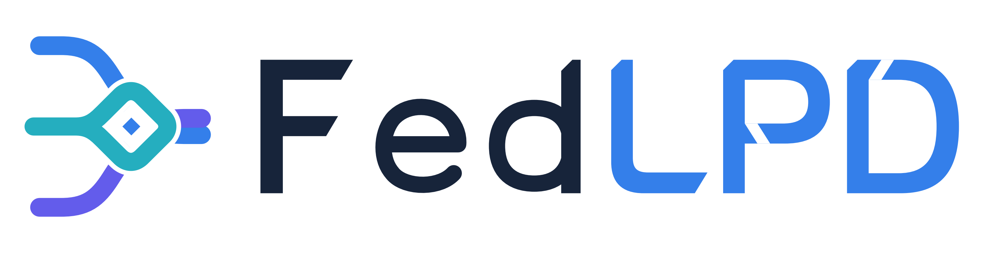
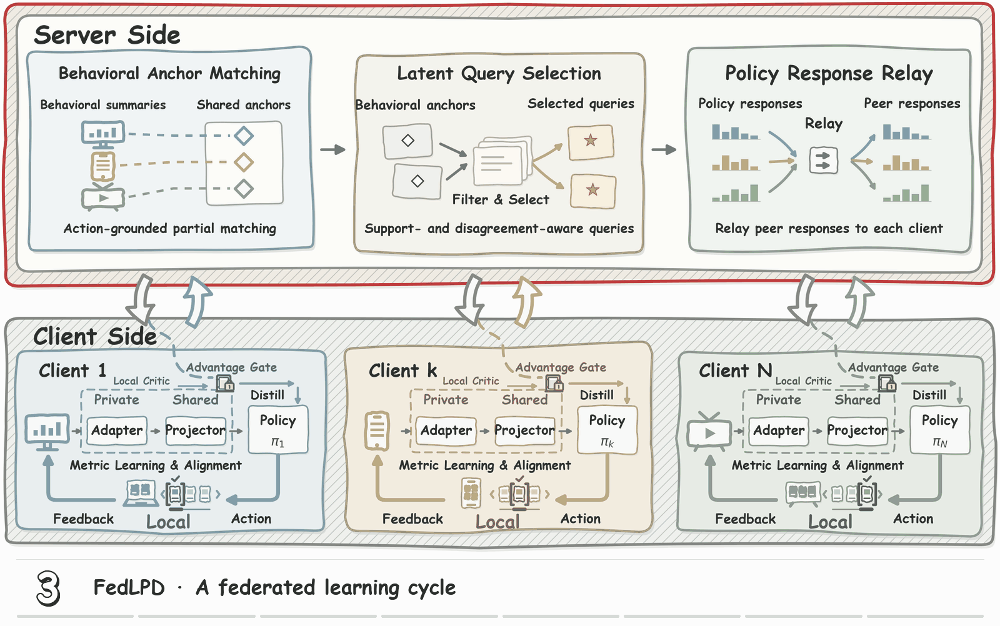

<p align="center">
  
</p>

<h2 align="center">
  Behavioral Latent Alignment for Federated<br>
  Reinforcement Learning in Recommendation
</h2>

<p align="center">
  <a href="pyproject.toml"></a>
  <a href="https://pytorch.org/"></a>
  <a href="#experiments"></a>
</p>

<p align="center">
  <a href="#overview">Overview</a> &nbsp;·&nbsp;
  <a href="#method-overview">Method</a> &nbsp;·&nbsp;
  <a href="#installation">Installation</a> &nbsp;·&nbsp;
  <a href="#data-preparation">Data</a> &nbsp;·&nbsp;
  <a href="#experiments">Experiments</a> &nbsp;·&nbsp;
  <a href="#output-files">Outputs</a>
</p>

<a id="overview"></a>

## 📌 Overview

We present **FedLPD**, a federated reinforcement learning method for recommendation with heterogeneous client representations. We use behavioral information to align local latent spaces and personalized policy distillation to transfer knowledge across clients. In this repository, we provide the code for preparing the environments, training FedLPD and the comparison methods, and exporting numerical results.

- **Behavioral latent alignment.** We use local behavioral estimates to establish correspondences across heterogeneous client representations.
- **Personalized policy distillation.** We use supported latent queries and recipient-specific teachers to transfer policy knowledge across clients.
- **Reproducible evaluation.** We provide a shared experimental workflow for KuaiSim and RecSim, with fixed interaction budgets and numerical result exports.

<a id="method-overview"></a>

## 🧩 Method Overview

<p align="center">
  
</p>

We organize FedLPD into a shared server workflow and local client updates, as shown above. We retain private observation histories and replay data on each client.

On the **server side**, we coordinate three steps:

1. **Behavioral Anchor Matching.** We match client behavioral summaries grounded in shared reference actions to construct shared anchors through partial matching.
2. **Latent Query Selection.** We filter candidate queries using replay support and select queries based on policy disagreement, providing a common interface for policy exchange.
3. **Policy Response Relay.** We collect policy responses to the selected queries and relay peer responses to each recipient client.

On the **client side**, we map private observations through a private adapter and shared projector to the policy, and use metric learning and alignment to shape the latent representation. Each client uses its own **local critic and advantage gate** to evaluate peer responses, form a personalized teacher, and distill accepted guidance into its policy. Local action–feedback interaction continues to supply experience for learning.

<a id="installation"></a>

## ⚙️ Installation

We use **Python 3.11 or 3.12**. The commands below assume a Linux shell and should be run from the repository root. You can use an existing environment or create one:

```bash
python -m venv .venv
source .venv/bin/activate
```

For GPU experiments, first install a [PyTorch build compatible with your CUDA setup](https://pytorch.org/get-started/locally/) in the active environment. Then install this project and check that PyTorch and RecSim are available:

```bash
python -m pip install -e .
python -m pip install --no-deps recsim==0.2.4
python -m fedlpd doctor --device cuda:0 --strict
```

We install RecSim without its unused TensorFlow/Dopamine dependencies. For a CPU environment check, replace `--device cuda:0` with `--device cpu`.

<a id="data-preparation"></a>

## 📦 Data Preparation

We use the public [KuaiRand-1K dataset](https://zenodo.org/records/10439422/files/KuaiRand-1K.tar.gz) to prepare the KuaiSim environment. Download and extract it under `data/`. The archive MD5 is `6b0b9c8222d67fcd4c676218edca3f1f`.

Prepare the interaction logs and fit the response model with the following commands. The first command constructs the prepared dataset; the second saves the fitted model to `data/response.pt`:

```bash
python -m fedlpd prepare --config configs/experiment.json --logs data/KuaiRand-1K/data/log_standard_4_08_to_4_21_1k.csv data/KuaiRand-1K/data/log_standard_4_22_to_5_08_1k.csv --output data/prepared
python -m fedlpd fit-response --config configs/experiment.json --data-dir data/prepared --output data/response.pt --device cuda:0
```

We reuse these prepared assets across the comparison methods. If you store them elsewhere, update `--data-dir` and `--response` in the experiment command below. **RecSim does not require an external dataset.**

<a id="experiments"></a>

## 🚀 Run Experiments

### Check the workflow with synthetic data

We provide a small synthetic run to check calibration, training, and result export before launching the full experiments. It runs on CPU without downloading KuaiRand or fitting a response model:

```bash
python scripts/run_experiment.py --smoke --devices cpu --output outputs/smoke
```

This check writes its outputs to `outputs/smoke/`. Its synthetic results are for software validation and must not be used as paper results.

### Run the complete experiments on four GPUs

We run our experiments on **four GPUs in parallel**, so the provided launch command also uses four GPUs. Each GPU handles one experiment run at a time, and the scheduler assigns the next run when that GPU becomes available:

```bash
python scripts/run_experiment.py --data-dir data/prepared --response data/response.pt --devices cuda:0,cuda:1,cuda:2,cuda:3 --output outputs/full
```

The launcher executes the complete workflow:

1. Calibrate validation return targets with two independent FedAvg experiments.
2. Check the environments and freeze the experiment configuration.
3. Run all 90 comparison experiments across the available GPUs.
4. Export numerical tables, trajectories, diagnostics, and run evidence.

Training continues to the configured budget even when a run reaches its return target early.

### Resume an interrupted run

To resume recoverable runs, rerun the same command with the same output directory. Use a new output directory if you change the code, configuration, input paths, or worker allocation.

<details>
<summary><strong>Optional: fewer GPUs and CPU affinity</strong></summary>

For fewer GPUs, adjust `--devices` to list the available devices. Optional `--cpu-affinities` assigns one comma-separated CPU list per GPU; separate the lists with semicolons and ensure that they do not overlap. Choose CPU IDs that are available on your server.

</details>

<a id="experimental-protocol"></a>

## 📊 Experimental Protocol

We evaluate FedLPD in two environments: a **KuaiSim environment built from KuaiRand-1K interaction logs** and a **RecSim environment generated locally**. We adapt the baselines to the shared recommendation environment and use the same task and evaluation protocol within each environment.

| Setting | Configuration |
| :--- | :--- |
| Clients | 5 per environment |
| Random seeds | 2026, 2027, 2028 |
| KuaiSim training budget | 80,000 requests per client |
| RecSim training budget | 40,000 requests per client |
| Learned baselines | Local RL, FedAvg, FedRAG, GPFedRec, FedHPD, FedSlate |
| Additional comparisons | Random and seven FedLPD ablations |
| Complete comparison matrix | 90 runs across both environments and all three seeds |

The configuration is stored in [`configs/experiment.json`](configs/experiment.json). Two independent FedAvg calibration experiments set validation return targets before the comparison runs.

<details>
<summary><strong>The seven ablations, run in both environments</strong></summary>

| Variant | Component removed or replaced |
| :--- | :--- |
| `metric_off` | Metric-loss supervision; behavioral estimates remain available |
| `alignment_off` | Explicit alignment loss |
| `signature_off` | Signature grounding in matching |
| `coverage_off` | Replay-support filtering; matching confidence is retained |
| `random_probes` | Disagreement-based selection, replaced with random selection under the same budget |
| `uniform_teacher` | Recipient-advantage teacher, replaced with a uniform supported-peer teacher |
| `distillation_off` | Policy distillation; representation learning and aggregation remain |

</details>

<a id="output-files"></a>

## 📁 Output Files

We save aggregated results under `outputs/full/results/finish/report/` and retain the underlying run records for further analysis:

| Location | Contents |
| :--- | :--- |
| `report/paper_tables/` | Six CSV tables covering performance, ablations, probe activity, alignment, and training costs |
| `report/data/` | Test trajectories, teacher weights, paired client gains, and alignment diagnostics in CSV/JSON/NPZ format |
| `report/costs_by_seed.csv` | Training time, communication volume, and rounds to the fixed validation return target for each run |
| `outputs/full/runs/` | Run configurations, evaluation records, communication logs, and checkpoints |

In this table, `report/` refers to `outputs/full/results/finish/report/`. We record discounted return, reward per request, and session length, together with the diagnostic and cost measurements. Targets that are not reached within the training budget remain marked `NR`; communication rounds are marked `N/A` for Local RL and Random.

**We export numerical data only.** Readers can use these data to create their own figures; plotting code is not included. The illustrations in this README describe the project and its method. This repository does not distribute datasets, trained models, or experimental results.
